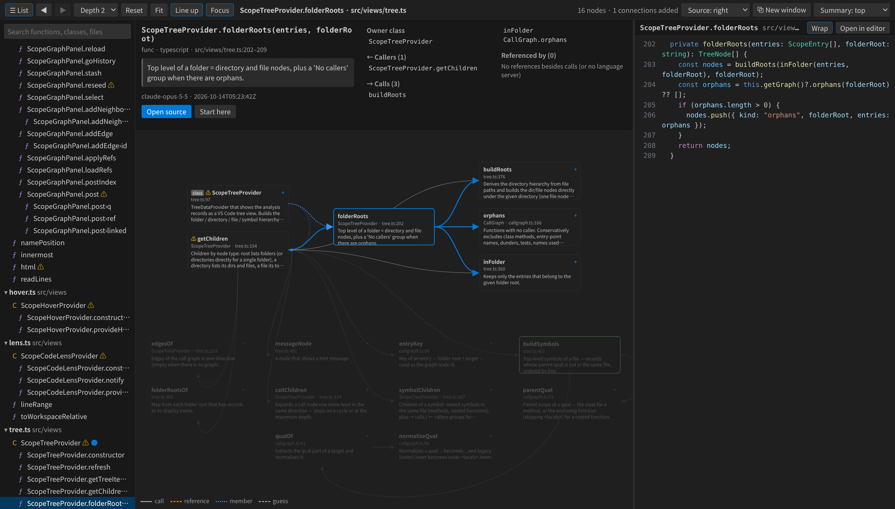
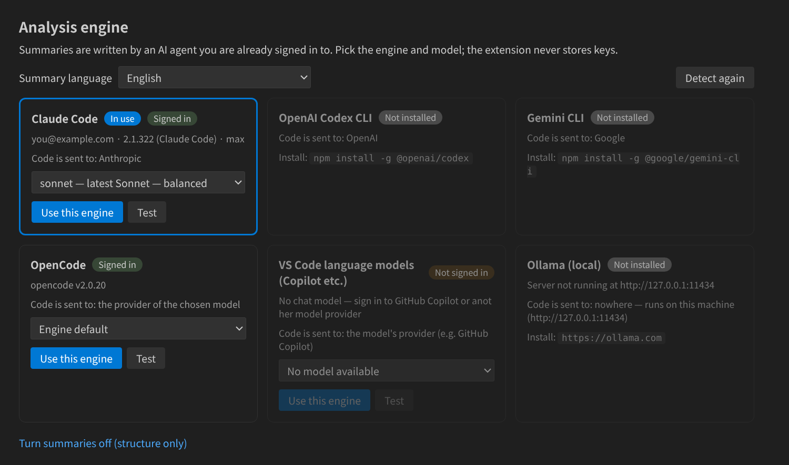

# Project Scope
[English](README.md) · [한국어](README.ko.md) · **日本語** · [简体中文](README.zh-CN.md) · [繁體中文](README.zh-tw.md)

> プロジェクト内のすべての関数が何をするのか一目で把握 — 要約、呼び出しグラフ、陳腐化チェックを、VS Code の中で直接。



Project Scope は、コードベースの**関数単位のマップ**を維持します。各関数・クラスの一段落の要約、誰が呼んでいるか、何を呼んでいるか、そして要約後にコードが変更されたかどうか。
構造は VS Code 本体の言語サーバーから取得します。要約は、Claude Code、Codex、Gemini、OpenCode、GitHub Copilot、ローカルの Ollama モデルなど、**すでにサインイン済みの** AI エージェントが生成します。Project Scope が API キーを要求したり保存したりすることは**ありません**。

すべてプレーンな JSON Lines として `.scope/analysis.jsonl` に保存されます。コミットしても、チームで共有しても、別の AI エージェントに書き込ませることもできます。

---

## できること

### 見慣れないコードベースをすばやく理解する
- **Project Scope** サイドブラウズ: `フォルダ › ファイル › クラス › 関数` の各階層に要約が付いています。
- エディターの任意の関数にホバーすると、要約・引数・呼び出し先を確認できます。
- ツリーで関数を展開すると、**→ 呼び出し先**と**← 呼び出し元**を再帰的にたどれます。循環には ↻ が付きます。

### 呼び出しフローを視覚的に探索する
- **Scope Explorer** を開くと、**ソース一覧**、操作できる**呼び出しグラフ**、**要約パネル**の3ペイン構成のウィンドウになります。
- ノードをクリックすると、その呼び出し元・呼び出し先・**参照**(言語サーバーの *参照の検索* 経由)・クラスメンバーがキャンバスに追加されます。探索に合わせてグラフは育ち、起点を行き来することもできます。
- **Line up** を使うと、選択関数の上流(呼び出し元、左側)と下流(呼び出し先、右側)が一段の横並びになり、それ以外は下部の暗い領域へ移動します。カードがスライドして動きが分かります。オフにすると通常の縦並びに戻ります。**Focus** を使うと、選択につながっていない要素だけが別途暗くなります。
- 要約パネルは既定でグラフの**上**にあり、片側に要約、反対側に呼び出し元・呼び出し先・参照が表示されます。右側へ移動したり非表示にしたりできます。
- コードは下・右・左にドックできる**ソースペイン**で読めます。VS Code のテーマと同じシンタックスカラーが使えます。
- 呼び出しフローは**Mermaid フローチャート**としてコピーでき、ドキュメントやプルリクエストに使えます。

冒頭のスクリーンショットでは `folderRoots` が選択されています。呼び出し元が左に並び、呼び出し先が右にあります。キャンバスの残りは下部で暗くなっており、⚠ は要約後にコードが変更された関数を示します。

### コードが変わっても要約を正しく保つ
- すべての要約には関数本体のハッシュが保存されます。本体が変わると、その関数には ⚠ **stale**(陳腐化)が付きます。
- **Refresh ↻** は言語サーバー経由で構造を読み直します。LLM を使わないため無料です。
  - 移動した関数は要約を保持します。
  - 削除された関数は削除済みとしてマークされます。
  - 新しい関数は*未解析*として表示されます。
- Refresh は保存時、起動時、git のブランチ切り替え・pull・コミット後に自動実行されます。
- **Analyze ✦** は、stale および新規の関数だけを AI エンジンに送ります。必要なものすべて、現在のファイル、カーソル位置の関数、あるいはツリー・グラフ・ホバー・CodeLens から単一の関数を解析できます。
- 任意の**自動解析**では、関数をクリックしたりファイルを保存したりしたときに変更された関数を要約します(1時間あたりの上限付き)。

### デッドコードの候補を見つける
- **呼び出し元なし**グループには、プロジェクト内に呼び出し元が見つからない関数が一覧表示されます。判定は保守的です。エントリーポイント、テスト、クラスメソッド、名前参照されている関数は除外されます。

### いつもの AI エンジンを選ぶ
- **Scope: Choose Analysis Engine** は、インストール・サインイン済みのエージェントを検出します。エンジンごとに、アカウント、コードの送信先、利用可能なモデル、**Test** ボタンが表示されます。

| エンジン | 呼び出し方法 | コードの送り先 |
|---|---|---|
| Claude Code | `claude -p`(サインイン済み CLI)| Anthropic |
| OpenAI Codex CLI | `codex exec --sandbox read-only` | OpenAI |
| Gemini CLI | `gemini -p` | Google |
| OpenCode | `opencode run` | OpenCode で設定したプロバイダー |
| VS Code 言語モデル | `vscode.lm`(GitHub Copilot など)| そのモデルのプロバイダー |
| Ollama | ローカルの HTTP API | **手元のマシンから出ない** |



### 自分の言語で使う
- UI は英語、한국어、日本語、简体中文、繁體中文の5言語からなり、VS Code の表示言語に追従します。
- 要約もこれらの言語で書けます。初回解析時に Project Scope がどの言語にするか尋ねます。既存の要約で最も多い言語を提案し、選択はワークスペースに保存されます。

### 他の AI エージェントにも書き込ませる
- **Scope: Install Contract (AGENTS.md)** は、プロジェクトルートに1ページのスキーマを書き込みます。任意のコーディングエージェント(Claude Code、Cursor、Codex …)に渡せば、そのエージェントは `.scope/analysis.jsonl` へ自らの解析を追記できます。ファイルは追記専用で、各関数は最後の行が有効になるため、拡張機能とエージェントが安全に共有できます。

---

## はじめに

1. 拡張機能をインストールし、プロジェクトを開きます。
2. コマンドパレットから **Scope: Choose Analysis Engine** を実行し、サインイン済みのエンジンを選びます。**Test** を押して動作を確認できます。
3. ソースファイルを開き、**Scope: Analyze → Current file** を実行します。聞かれたら要約の言語を選びます。
4. アクティビティバーの **Project Scope** ビューを開くか、ステータスバーの `Scope …` をクリックして Explorer を開きます。

フォルダ全体を一度に解析するには、`projectScope.scanInclude`(例: `src/**`)を設定して **Scope: Analyze → Everything that needs analysis** を実行します。
一度ファイルを解析すると、同じトップレベルフォルダにある新しいファイルは自動的に検出されます。

**対応言語:** TypeScript/JavaScript、Python、C#、C/C++、Rust、Go、Java、Kotlin、Swift、Ruby、PHP、Scala、Dart。
各言語には document symbols を提供する言語サーバーが必要です。通常はその言語の VS Code 拡張機能でインストールされています。同名関数を区別するための import 追跡は、Python、TS/JS、C#、C/C++、Rust、Go、Java/Kotlin に対応しています。

---

## コマンド

| コマンド | 概要 |
|---|---|
| `Scope: Refresh` | レコードを再読み込みし、構造を読み直します(移動・新規・削除された関数)。LLM 不要。 |
| `Scope: Analyze` | 必要なものすべて、現在のファイル、カーソル位置の関数のいずれかに対して要約を書きます。キャンセル可能。 |
| `Scope: Choose Analysis Engine` | サインイン済みエージェントを検出し、エンジン・モデル・要約言語を選んでテストを実行します。 |
| `Scope: Open Explorer` | 一覧 · グラフ · 要約のウィンドウを開きます。 |
| `Scope: Open Explorer at This Function` | カーソル位置の関数を起点に Explorer を開きます(エディタータイトルのボタン)。 |
| `Scope: Open Call Graph` | 同様に、カーソル下またはツリーで選択中の関数・クラスに対して開きます。 |
| `Scope: Show Summary` | 現在のシンボルの要約を表示します。 |
| `Scope: Show Flow` | その関数が呼んでいる関数を一覧表示し、ジャンプできます。 |
| `Scope: Show Callers` | 呼び出し元を一覧表示し、ジャンプできます。 |
| `Scope: Copy Mermaid Flowchart` | 呼び出しフローを Mermaid 形式でコピーします。 |
| `Scope: Install Contract (AGENTS.md)` | 外部エージェント向けの解析スキーマを書き出し、`.scope/` を作成します。 |

これらの操作は、ツリーのコンテキストメニュー、インラインボタン、CodeLens、ホバーのリストからも実行できます。
ステータスバー(`Scope 210 · ⚠3 · new 2`)をクリックすると Explorer が開き、そのツールチップには Refresh・Analyze・Engine のリンクがあります。

---

## 設定

### 解析エンジン

| 設定 | 既定値 | 説明 |
|---|---|---|
| `projectScope.analyzer` | `claude-cli` | 要約を書くエンジン: `claude-cli`、`codex-cli`、`gemini-cli`、`opencode`、`vscode-lm`、`ollama`、または `off`。`off` の場合は構造の更新のみ行われ、コードはどこにも送信されません。 |
| `projectScope.analyzeModel` | `sonnet` | エンジン固有の形式でのモデル名。Claude Code なら `sonnet` / `haiku` / `opus`、OpenCode なら `provider/model` など。空欄ならエンジンの既定値を使用します。 |
| `projectScope.summaryLanguage` | `ask` | 要約の言語。`ask` は初回解析前に尋ねて、その回答をワークスペースに保存します。その他の値: `ui`(VS Code の表示言語)、`auto`(コードのコメントと同じ)、`en`、`ko`、`ja`、`zh-cn`、`zh-tw`。 |
| `projectScope.claudePath` | `claude` | Claude Code CLI へのパス(`PATH` 上にない場合)。 |
| `projectScope.codexPath` | `codex` | Codex CLI へのパス。 |
| `projectScope.geminiPath` | `gemini` | Gemini CLI へのパス。 |
| `projectScope.opencodePath` | `opencode` | OpenCode CLI へのパス。 |
| `projectScope.ollamaUrl` | `http://127.0.0.1:11434` | Ollama サーバーの URL。 |

### 自動処理

| 設定 | 既定値 | 説明 |
|---|---|---|
| `projectScope.autoAnalyze` | `off` | `off`: Analyze を押したときのみ。`onClick`: ツリーやグラフで変更・新規の関数をクリックしたとき。`onSave`: クリック時に加え、ファイル保存時にその中の変更・新規関数も処理。AI エンジンを使用します。 |
| `projectScope.autoAnalyzeMaxPerHour` | `60` | 自動解析が1時間に要約する関数数の上限。手動解析は無制限です。 |
| `projectScope.scanOnSave` | `true` | 保存時に、そのファイルの構造を読み直します。LLM 不要。 |
| `projectScope.scanOnStartup` | `true` | 起動の数秒後に構造を更新します。LLM 不要。 |
| `projectScope.gitIntegration` | `true` | git で変更されたファイルと未追跡ファイルを Refresh 対象に含め、ブランチ切り替え・pull・コミット後にも更新します。ハッシュを使うため、git がなくても動作します。 |
| `projectScope.scanInclude` | *(空)* | 新しいソースファイルを探すための glob(ワークスペースフォルダ基準)。空の場合は、既に解析済みのファイルのトップレベルフォルダが対象になります(例: `src/**`)。 |
| `projectScope.scanExclude` | `**/{node_modules,out,dist,build,target,bin,obj,.git,.scope,test,tests,__tests__,spec,fixtures,vendor,third_party}/**` | 新規ファイルの探索時に除外するパスの glob。 |

### 表示

| 設定 | 既定値 | 説明 |
|---|---|---|
| `projectScope.graphOpenIn` | `window` | Explorer の初回の開き方: `window`(別の VS Code ウィンドウ)、`beside`(隣のエディターグループのタブ)、`active`(現在のグループのタブ)。 |
| `projectScope.openExplorerOnStartup` | `false` | ワークスペースを開いたときに Explorer を開きます。 |
| `projectScope.graphDepth` | `3` | グラフと Mermaid 出力の既定の呼び出し先の深さ(1〜4、Explorer 内で変更可能)。 |
| `projectScope.callTreeMaxDepth` | `6` | ツリーで呼び出し・呼び出し元のチェーンを展開する最大の深さ。 |
| `projectScope.jsonlPath` | `.scope/analysis.jsonl` | 解析レコードの場所(ワークスペース基準)。 |

---

## プライバシーとコスト

- **API キー不要。** Project Scope は、すでにサインイン済みの CLI や VS Code モデルを、そのツール自身の認証を使って呼び出します。CLI は一時ディレクトリで動作するため、プロジェクトのファイルやエージェントへの指示(AGENTS.md など)を拾いません。
- **送信されるもの:** 解析対象の関数の本体と、その名前・ファイルパスのみが、選択したエンジンへ送られます。エンジン選択画面に、エンジごとの送信先が表示されます。コードを手元に留めるには **Ollama** を使うか、`projectScope.analyzer` を `off` にして何も送らないようにします。
- **課金されるもの:** Analyze のみです(エンジンのクォータや従量課金を使用)。Refresh、ツリー、グラフ、ホバー、stale 判定は無料で、オフラインでも動作します。
- **保存されるもの:** ワークスペース内の `.scope/analysis.jsonl`。要約とメタデータのみで、コードのコピーは含みません。

---

## レコード形式

`.scope/analysis.jsonl` の各行が、1つの関数またはクラスに対応します:

```json
{"v":1,"target":"func:src/core.py:build_slice","kind":"func","name":"build_slice",
 "file":"src/core.py","line":186,"endLine":214,"lang":"python","srcHash":"a3f9c1d2e4b5a6c7",
 "summary":"Builds the call slice around a seed function…","calls":["_resolve"],
 "model":"claude-sonnet-4-5","generatedAt":"2026-10-12T09:30:00Z"}
```

スキーマの全文は [AGENTS.md](AGENTS.md) にあります。

---

## 必要環境

- VS Code 1.90 以降。Remote SSH 上でも動作し、リモートホスト向けのシンタックスカラーを同梱しています。
- 要約には次のいずれかが必要です: インストール・サインイン済みの Claude Code、Codex CLI、Gemini CLI、OpenCode。GitHub Copilot などの VS Code チャットモデル。あるいは Ollama サーバー。

## サードパーティ

- `vscode-textmate`、`vscode-oniguruma`(MIT、Microsoft)構文のトークン化に使用。
- `resources/syntax`: [tm-grammars / tm-themes](https://github.com/shikijs/textmate-grammars-themes) の TextMate 文法とテーマ。元のライセンスは `resources/syntax/NOTICE-grammars` と `LICENSE-*` を参照。

## ライセンス

MIT
