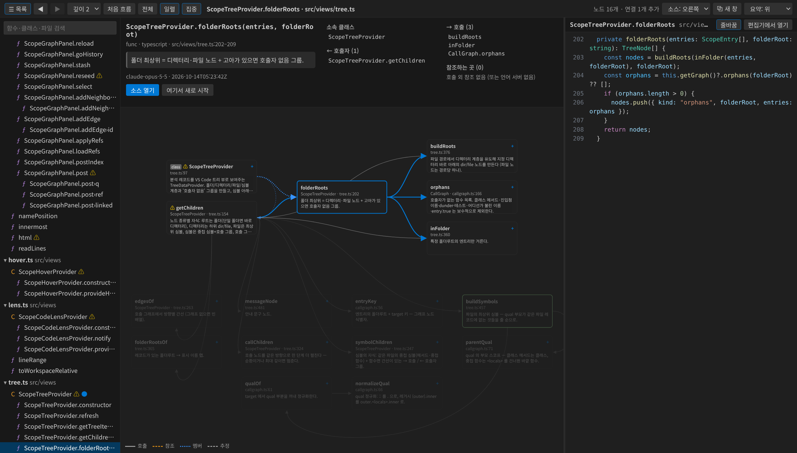
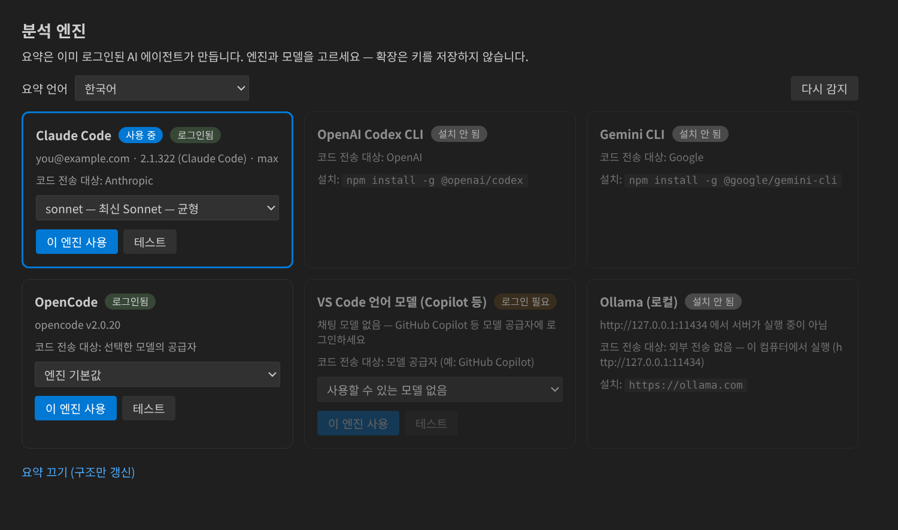

# Project Scope

[English](README.md) · **한국어** · [日本語](README.ja.md) · [简体中文](README.zh-CN.md) · [繁體中文](README.zh-tw.md)

> 프로젝트의 모든 함수가 무엇을 하는지 VS Code 안에서 바로 확인하세요. 요약, 호출 그래프, 변경 감지를 제공합니다.



Project Scope는 코드베이스를 **함수 단위 지도**로 만들어 둡니다. 함수·클래스마다 한 문단 요약이 붙고, 누가 호출하는지, 무엇을 호출하는지, 요약한 뒤 코드가 바뀌었는지 보여 줍니다.
구조는 VS Code의 언어 서버로 읽습니다. 요약은 **이미 로그인해 둔 AI 에이전트**가 씁니다(Claude Code, Codex, Gemini, OpenCode, GitHub Copilot, 로컬 Ollama 등). Project Scope는 **API 키를 묻거나 저장하지 않습니다.**

결과는 모두 `.scope/analysis.jsonl`에 JSON Lines로 저장됩니다. 커밋해서 팀과 나누거나 다른 AI 에이전트가 함께 쓰게 할 수 있습니다.

---

## 이걸로 할 수 있는 일

### 처음 보는 코드베이스를 빠르게 파악
- **Project Scope** 사이드바에서 `폴더 › 파일 › 클래스 › 함수` 순으로 둘러보며 요약을 읽습니다.
- 에디터에서 함수 위에 마우스를 올리면 요약·파라미터·호출 목록이 뜹니다.
- 트리에서 함수를 펼치면 **→ 호출**과 **← 호출자**를 계속 따라갈 수 있습니다. 순환은 ↻로 표시합니다.

### 호출 흐름을 그래프로 탐색
- **Scope 탐색 창**은 **소스 목록**, **호출 그래프**, **요약 패널**의 3단 창입니다.
- 노드를 클릭하면 그 노드의 호출자, 호출, **참조하는 곳**(언어 서버의 참조 찾기), 클래스 멤버가 캔버스에 쌓입니다. 탐색할수록 그래프가 넓어지고, 뒤로/앞으로 버튼으로 이전 시작점에 돌아갈 수 있습니다.
- **일렬**을 켜면 선택한 함수의 상위 트리(호출자, 왼쪽)와 하위 트리(호출, 오른쪽)를 가로 한 줄로 세우고, 나머지는 아래쪽 흐린 영역으로 보냅니다. 카드가 미끄러지듯 옮겨 가서 무엇이 어디로 갔는지 따라갈 수 있습니다. 끄면 기존 열 배치로 돌아갑니다. **집중**은 선택과 연결되지 않은 카드를 흐리게 하는 기능으로 따로 켜고 끕니다.
- 요약 패널은 기본으로 **그래프 위**에 있습니다. 한쪽에 요약, 다른 쪽에 호출자·호출·참조 목록이 나옵니다. 오른쪽으로 옮기거나 숨길 수 있습니다.
- **소스 영역**을 아래·오른쪽·왼쪽에 붙여 코드를 읽습니다. 문법 색상은 현재 VS Code 테마와 같습니다.
- 호출 흐름을 **Mermaid 흐름도**로 복사해 문서나 PR에 붙일 수 있습니다.

맨 위 화면은 `folderRoots`를 선택한 모습입니다. 호출자가 왼쪽에, 이 함수가 호출하는 함수가 오른쪽에 한 줄로 서 있습니다. 나머지 카드는 아래쪽에 흐리게 모여 있고, ⚠는 요약한 뒤 코드가 바뀐 함수입니다.

### 코드가 바뀌어도 요약을 정확하게 유지
- 요약마다 함수 본문의 해시를 저장합니다. 본문이 바뀌면 그 함수에 ⚠ **변경됨** 표시가 붙습니다.
- **갱신 ↻**은 언어 서버로 구조를 다시 읽습니다. LLM을 쓰지 않으므로 비용이 없습니다.
  - 위치만 옮긴 함수는 요약을 그대로 씁니다.
  - 지운 함수는 삭제로 표시합니다.
  - 새 함수는 *분석 전*으로 표시합니다.
- 갱신은 저장할 때, VS Code를 시작할 때, git 브랜치 전환·pull·commit 뒤에 자동으로 실행됩니다.
- **분석 ✦**은 바뀐 함수와 새 함수만 AI 엔진에 보냅니다. 분석 범위는 "분석이 필요한 것 전부", 현재 파일, 커서 위치 함수 중에서 고르거나, 트리·그래프·Hover·CodeLens에서 함수 하나만 분석할 수도 있습니다.
- **자동 분석**을 켜면 바뀐 함수를 클릭하거나 파일을 저장할 때 요약을 만듭니다. 시간당 한도가 있습니다.

### 쓰이지 않는 코드 후보 찾기
- **호출자 없음** 그룹에는 프로젝트 안에서 호출하는 곳을 찾지 못한 함수가 모입니다. 진입점, 테스트, 클래스 메서드, 이름이 어딘가에서 쓰인 함수는 빼는 보수적 판정입니다.

### 이미 쓰는 AI 엔진 그대로 사용
- **Scope: 분석 엔진 선택**을 실행하면 설치·로그인된 에이전트를 찾아 보여 줍니다. 엔진마다 계정, 코드가 전송되는 곳, 고를 수 있는 모델, **테스트** 버튼이 있습니다.

| 엔진 | 호출 방식 | 코드 전송 대상 |
|---|---|---|
| Claude Code | `claude -p` (로그인된 CLI) | Anthropic |
| OpenAI Codex CLI | `codex exec --sandbox read-only` | OpenAI |
| Gemini CLI | `gemini -p` | Google |
| OpenCode | `opencode run` | OpenCode에 설정한 공급자 |
| VS Code 언어 모델 | `vscode.lm` (GitHub Copilot 등) | 해당 모델 공급자 |
| Ollama | 로컬 HTTP API | **내 컴퓨터 밖으로 나가지 않음** |



### 원하는 언어로 사용
- 메뉴와 화면은 English, 한국어, 日本語, 简体中文, 繁體中文을 지원하며 VS Code 표시 언어를 따릅니다.
- 요약도 이 언어들 중 하나로 씁니다. 처음 분석할 때 어떤 언어로 쓸지 묻습니다. 기존 요약에서 가장 많이 쓰인 언어를 추천하고, 고른 언어는 이 워크스페이스 설정에 저장합니다.

### 다른 AI 에이전트와 함께 쓰기
- **Scope: 규약 설치 (AGENTS.md)**를 실행하면 프로젝트 루트에 한 페이지짜리 스키마가 생깁니다. 이 파일을 코딩 에이전트(Claude Code, Cursor, Codex 등)에게 주면 에이전트가 직접 분석해 `.scope/analysis.jsonl`에 기록합니다. 파일은 추가만 하고 같은 함수는 마지막 줄을 최신으로 보므로, 확장과 에이전트가 안전하게 같이 씁니다.

---

## 시작하기

1. 확장을 설치하고 프로젝트를 엽니다.
2. 명령 팔레트에서 **Scope: 분석 엔진 선택**을 실행하고 로그인된 엔진을 고릅니다. **테스트**를 눌러 동작을 확인합니다.
3. 소스 파일을 열고 **Scope: 분석 → 현재 파일**을 실행합니다. 요약 언어를 물으면 고릅니다.
4. 활동 표시줄의 **Project Scope** 뷰를 열거나, 상태바의 `Scope …`를 눌러 탐색 창을 엽니다.

폴더 전체를 한 번에 분석하려면 `projectScope.scanInclude`를 지정하고(예: `src/**`) **Scope: 분석 → 분석이 필요한 것 전부**를 실행하세요.
한 번 분석한 파일이 있으면 같은 최상위 폴더의 새 파일은 자동으로 찾습니다.

**지원 언어:** TypeScript/JavaScript, Python, C#, C/C++, Rust, Go, Java, Kotlin, Swift, Ruby, PHP, Scala, Dart.
문서 심볼을 제공하는 언어 서버가 있어야 하며, 보통 각 언어의 VS Code 확장을 설치하면 함께 들어옵니다. 같은 이름 함수를 구분하는 import 추적은 Python, TS/JS, C#, C/C++, Rust, Go, Java/Kotlin을 지원합니다.

---

## 명령

| 명령 | 하는 일 |
|---|---|
| `Scope: 갱신` | 기록과 구조를 다시 읽습니다(위치 이동·새 함수·삭제 반영). LLM을 쓰지 않습니다. |
| `Scope: 분석` | 분석이 필요한 것 전부, 현재 파일, 커서 위치 함수 중 골라 요약을 씁니다. 진행 중에 취소할 수 있습니다. |
| `Scope: 분석 엔진 선택` | 로그인된 에이전트를 찾고, 엔진·모델·요약 언어를 고르고, 테스트합니다. |
| `Scope: 탐색 창 열기` | 목록 · 그래프 · 요약 창을 엽니다. |
| `Scope: 이 함수로 탐색 창 열기` | 커서 위치 함수에서 탐색 창을 엽니다(에디터 제목줄 버튼). |
| `Scope: 호출 그래프 열기` | 커서 위치나 트리에서 고른 함수·클래스에서 탐색 창을 엽니다. |
| `Scope: 요약 보기` | 현재 심볼의 요약을 보여 줍니다. |
| `Scope: Flow 보기` | 이 함수가 호출하는 함수 목록을 보여 주고, 고르면 그 소스로 이동합니다. |
| `Scope: Callers 보기` | 호출자 목록을 보여 주고, 고르면 그 소스로 이동합니다. |
| `Scope: Mermaid 흐름도 복사` | 호출 흐름을 Mermaid로 복사합니다. |
| `Scope: 규약 설치 (AGENTS.md)` | 외부 에이전트용 분석 스키마를 쓰고 `.scope/`를 만듭니다. |

같은 기능을 트리 우클릭 메뉴, 인라인 버튼, CodeLens, Hover 링크에서도 쓸 수 있습니다.
상태바(`Scope 210 · ⚠3 · 새 2`)를 누르면 탐색 창이 열리고, 툴팁에 갱신·분석·엔진 링크가 있습니다.

---

## 설정

### 분석 엔진

| 설정 | 기본값 | 설명 |
|---|---|---|
| `projectScope.analyzer` | `claude-cli` | 요약을 쓰는 엔진입니다. `claude-cli`, `codex-cli`, `gemini-cli`, `opencode`, `vscode-lm`, `ollama`, `off` 중 하나입니다. `off`이면 구조 갱신만 하고 코드를 어디에도 보내지 않습니다. |
| `projectScope.analyzeModel` | `sonnet` | 엔진 표기 그대로의 모델 이름입니다. 예: Claude Code는 `sonnet` / `haiku` / `opus`, OpenCode는 `공급자/모델`. 비우면 엔진 기본값을 씁니다. |
| `projectScope.summaryLanguage` | `ask` | 요약 언어입니다. `ask`는 처음 분석할 때 묻고 답을 워크스페이스에 저장합니다. 그 밖의 값: `ui`(VS Code 표시 언어), `auto`(코드 주석과 같은 언어), `en`, `ko`, `ja`, `zh-cn`, `zh-tw`. |
| `projectScope.claudePath` | `claude` | Claude Code CLI 경로입니다(`PATH`에 없을 때). |
| `projectScope.codexPath` | `codex` | Codex CLI 경로입니다. |
| `projectScope.geminiPath` | `gemini` | Gemini CLI 경로입니다. |
| `projectScope.opencodePath` | `opencode` | OpenCode CLI 경로입니다. |
| `projectScope.ollamaUrl` | `http://127.0.0.1:11434` | Ollama 서버 주소입니다. |

### 자동 동작

| 설정 | 기본값 | 설명 |
|---|---|---|
| `projectScope.autoAnalyze` | `off` | `off`: 분석 버튼을 누를 때만 요약합니다. `onClick`: 트리·그래프에서 바뀐 함수나 새 함수를 클릭하면 요약합니다. `onSave`: 클릭할 때와 파일을 저장할 때 그 파일의 바뀐·새 함수를 요약합니다. AI 엔진 사용량이 생깁니다. |
| `projectScope.autoAnalyzeMaxPerHour` | `60` | 자동 분석이 한 시간에 요약하는 최대 함수 수입니다. 수동 분석은 제한이 없습니다. |
| `projectScope.scanOnSave` | `true` | 저장할 때 그 파일의 구조를 다시 읽습니다. LLM을 쓰지 않습니다. |
| `projectScope.scanOnStartup` | `true` | 시작하고 몇 초 뒤 구조를 갱신합니다. LLM을 쓰지 않습니다. |
| `projectScope.gitIntegration` | `true` | git에서 바뀐 파일과 추적되지 않는 파일을 갱신에 포함하고, 브랜치 전환·pull·commit 뒤에 갱신합니다. git이 없어도 해시로 동작합니다. |
| `projectScope.scanInclude` | *(비어 있음)* | 새 소스 파일을 찾을 범위(glob, 워크스페이스 폴더 기준)입니다. 비우면 이미 분석된 파일들의 최상위 폴더를 씁니다(예: `src/**`). |
| `projectScope.scanExclude` | `**/{node_modules,out,dist,build,target,bin,obj,.git,.scope,test,tests,__tests__,spec,fixtures,vendor,third_party}/**` | 새 파일을 찾을 때 뺄 경로(glob)입니다. |

### 화면

| 설정 | 기본값 | 설명 |
|---|---|---|
| `projectScope.graphOpenIn` | `window` | 탐색 창을 처음 여는 위치입니다. `window`(VS Code 별도 창), `beside`(옆 편집기 그룹의 탭), `active`(현재 편집기 그룹의 탭). |
| `projectScope.openExplorerOnStartup` | `false` | 워크스페이스를 열 때 탐색 창을 자동으로 엽니다. |
| `projectScope.graphDepth` | `3` | 그래프와 Mermaid의 기본 호출 깊이입니다(1–4, 탐색 창에서 바꿀 수 있음). |
| `projectScope.callTreeMaxDepth` | `6` | 트리에서 호출·호출자 체인을 펼치는 최대 깊이입니다. |
| `projectScope.jsonlPath` | `.scope/analysis.jsonl` | 분석 기록 파일 위치입니다(워크스페이스 기준 상대 경로). |

---

## 보안과 비용

- **API 키가 필요 없습니다.** 이미 로그인한 CLI나 VS Code 모델을 그 도구의 인증 그대로 호출합니다. CLI는 임시 디렉터리에서 실행되므로 프로젝트 파일이나 에이전트 지시문을 읽어 들이지 않습니다.
- **보내는 것:** 분석하는 함수의 본문과 이름, 파일 경로만 선택한 엔진으로 보냅니다. 엔진 선택 창에 엔진마다 코드가 가는 곳이 나옵니다. 코드를 내 컴퓨터 밖으로 보내지 않으려면 **Ollama**를 쓰고, 아무것도 보내지 않으려면 `projectScope.analyzer`를 `off`로 두세요.
- **비용이 드는 것:** 분석만 엔진의 사용량이나 요금을 씁니다. 갱신, 트리, 그래프, Hover, 변경 감지는 무료이고 오프라인에서도 동작합니다.
- **저장하는 것:** 워크스페이스의 `.scope/analysis.jsonl`입니다. 요약과 메타데이터만 들어 있고 코드 사본은 없습니다.

---

## 기록 형식

`.scope/analysis.jsonl`의 한 줄이 함수나 클래스 하나입니다.

```json
{"v":1,"target":"func:src/core.py:build_slice","kind":"func","name":"build_slice",
 "file":"src/core.py","line":186,"endLine":214,"lang":"python","srcHash":"a3f9c1d2e4b5a6c7",
 "summary":"시드 함수 주변의 호출 조각을 만든다…","calls":["_resolve"],
 "model":"claude-sonnet-4-5","generatedAt":"2026-10-12T09:30:00Z"}
```

전체 스키마는 [AGENTS.md](AGENTS.md)에 있습니다.

---

## 요구 사항

- VS Code 1.90 이상. Remote SSH에서도 동작하며, 원격 호스트용 문법 색상을 함께 넣었습니다.
- 요약을 쓰려면 다음 중 하나가 필요합니다: 설치·로그인된 Claude Code, Codex CLI, Gemini CLI, OpenCode 중 하나, GitHub Copilot 같은 VS Code 채팅 모델, 또는 Ollama 서버.

## 서드파티

- `vscode-textmate`, `vscode-oniguruma` (MIT, Microsoft): 문법 토크나이저
- `resources/syntax`: [tm-grammars / tm-themes](https://github.com/shikijs/textmate-grammars-themes)에서 고른 TextMate 문법·테마. 원본 라이선스는 `resources/syntax/NOTICE-grammars`, `LICENSE-*`에 있습니다.

## 라이선스

MIT
