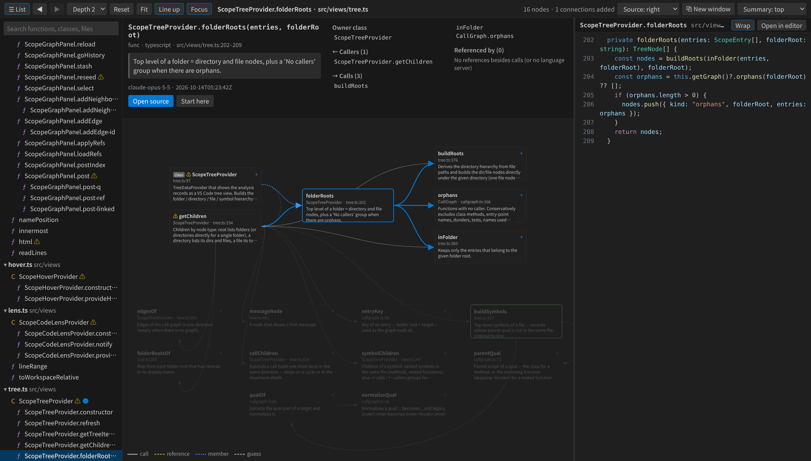
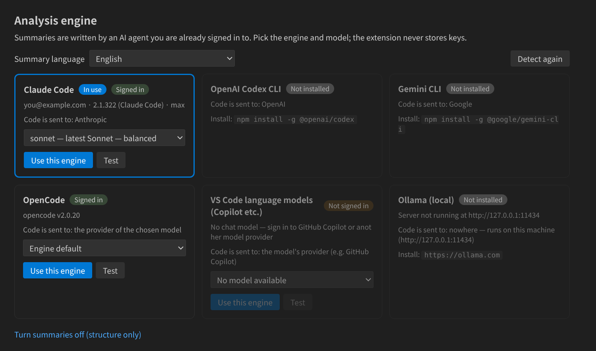

# Project Scope

**English** · [한국어](README.ko.md) · [日本語](README.ja.md) · [简体中文](README.zh-CN.md) · [繁體中文](README.zh-tw.md)

> See what every function in your project does — summaries, call graphs and stale-checks, right inside VS Code.



Project Scope keeps a **function-by-function map of your codebase**: a one-paragraph summary of each function and class, who calls it, what it calls, and whether the code has changed since it was summarized.
The structure comes from VS Code's own language servers. Summaries come from an AI agent you are **already signed in to**, such as Claude Code, Codex, Gemini, OpenCode, GitHub Copilot or a local Ollama model. Project Scope **never asks for or stores an API key**.

Everything is saved as plain JSON Lines in `.scope/analysis.jsonl`. You can commit it, share it with your team, or let another AI agent write to it.

---

## What you can do with it

### Understand an unfamiliar codebase fast
- Browse the **Project Scope** sidebar: `folder › file › class › function`, each with its summary.
- Hover over any function in the editor to read its summary, parameters and calls.
- Expand a function in the tree to follow **→ calls** and **← callers** recursively. Cycles are marked ↻.

### Explore call flows visually
- Open the **Scope Explorer**, a three-pane window with a **source list**, an interactive **call graph** and a **summary panel**.
- Click a node to add its callers, callees, **references** (via the language server's *Find References*) and class members to the canvas. The graph grows as you explore, and you can go back and forward between starting points.
- **Line up** places the selected function's whole upstream (callers, to the left) and downstream (callees, to the right) in one horizontal band and moves everything else to a dimmed area below. Cards slide into place so you can follow what moved. Turn it off to go back to the plain column layout. **Focus** separately dims everything not connected to the selection.
- The summary panel sits **above the graph** by default, with the summary on one side and callers, calls and references on the other. You can move it to the right or hide it.
- Read the code in a **source pane** docked below, right or left. It uses the same syntax colors as your VS Code theme.
- Copy any call flow as a **Mermaid flowchart** for docs or pull requests.

In the screenshot at the top, `folderRoots` is selected. Its callers are lined up on the left and the functions it calls on the right. The rest of the canvas is dimmed below, and ⚠ marks functions whose code changed after they were summarized.

### Keep summaries honest as the code changes
- Every summary stores a hash of the function body. When the body changes, the function shows ⚠ **stale**.
- **Refresh ↻** re-reads structure through the language server. It does not use an LLM and costs nothing.
  - Moved functions keep their summary.
  - Deleted functions are marked deleted.
  - New functions show as *not analyzed yet*.
- Refresh runs automatically on save, on startup and after git branch switches, pulls or commits.
- **Analyze ✦** sends only stale and new functions to your AI engine. You can analyze everything that needs it, the current file, the function at the cursor, or a single function from the tree, graph, hover or CodeLens.
- Optional **auto-analyze** summarizes changed functions when you click them or save the file, with an hourly limit.

### Find dead code candidates
- The **No callers** group lists functions with no caller found inside the project. Detection is conservative: entry points, tests, class methods and functions referenced by name are excluded.

### Pick the AI engine you already use
- **Scope: Choose Analysis Engine** detects which agents are installed and signed in. For each one it shows the account, where your code will be sent, the available models and a **Test** button.

| Engine | How it is called | Code goes to |
|---|---|---|
| Claude Code | `claude -p` (your signed-in CLI) | Anthropic |
| OpenAI Codex CLI | `codex exec --sandbox read-only` | OpenAI |
| Gemini CLI | `gemini -p` | Google |
| OpenCode | `opencode run` | the provider you configured in OpenCode |
| VS Code language models | `vscode.lm` (GitHub Copilot etc.) | the model's provider |
| Ollama | local HTTP API | **stays on your machine** |



### Work in your language
- The UI is available in English, 한국어, 日本語, 简体中文 and 繁體中文, following the VS Code display language.
- Summaries can be written in any of those languages. The first time you analyze, Project Scope asks which one to use. It suggests the language most of your existing summaries are in and saves your choice to the workspace.

### Let other AI agents contribute
- **Scope: Install Contract (AGENTS.md)** writes a one-page schema to your project root. Give it to any coding agent (Claude Code, Cursor, Codex …), and the agent can append its own analysis to `.scope/analysis.jsonl`. The file is append-only and the last line for each function wins, so the extension and agents can share it safely.

---

## Getting started

1. Install the extension and open a project.
2. Run **Scope: Choose Analysis Engine** from the Command Palette and pick an engine you are signed in to. Press **Test** to check it.
3. Open a source file and run **Scope: Analyze → Current file**. Choose the summary language when asked.
4. Open the **Project Scope** view in the Activity Bar, or click `Scope …` in the status bar to open the Explorer.

To analyze a whole folder at once, set `projectScope.scanInclude` (for example `src/**`) and run **Scope: Analyze → Everything that needs analysis**.
Once some files have been analyzed, new files in the same top-level folders are picked up automatically.

**Supported languages:** TypeScript/JavaScript, Python, C#, C/C++, Rust, Go, Java, Kotlin, Swift, Ruby, PHP, Scala and Dart.
Each language needs a language server that provides document symbols, usually installed through that language's VS Code extension. Import tracking for telling same-name functions apart covers Python, TS/JS, C#, C/C++, Rust, Go and Java/Kotlin.

---

## Commands

| Command | What it does |
|---|---|
| `Scope: Refresh` | Reload records and re-read structure (moved, new and deleted functions). No LLM. |
| `Scope: Analyze` | Write summaries for everything that needs it, the current file, or the function at the cursor. Cancellable. |
| `Scope: Choose Analysis Engine` | Detect signed-in agents, choose the engine, model and summary language, and run a test. |
| `Scope: Open Explorer` | Open the list · graph · summary window. |
| `Scope: Open Explorer at This Function` | Open the Explorer starting from the function at the cursor (editor title button). |
| `Scope: Open Call Graph` | Same, for the function or class under the cursor or selected in the tree. |
| `Scope: Show Summary` | Show the summary of the current symbol. |
| `Scope: Show Flow` | List the functions it calls and jump to one. |
| `Scope: Show Callers` | List its callers and jump to one. |
| `Scope: Copy Mermaid Flowchart` | Copy the call flow as Mermaid. |
| `Scope: Install Contract (AGENTS.md)` | Write the analysis schema for external agents and create `.scope/`. |

The same actions are available from the tree's context menu, inline buttons, CodeLens and hover links.
The status bar (`Scope 210 · ⚠3 · new 2`) opens the Explorer, and its tooltip has Refresh, Analyze and Engine links.

---

## Settings

### Analysis engine

| Setting | Default | Description |
|---|---|---|
| `projectScope.analyzer` | `claude-cli` | Engine that writes summaries: `claude-cli`, `codex-cli`, `gemini-cli`, `opencode`, `vscode-lm`, `ollama`, or `off`. With `off`, only the structure is refreshed and no code is sent anywhere. |
| `projectScope.analyzeModel` | `sonnet` | Model name in the engine's own format, for example `sonnet` / `haiku` / `opus` for Claude Code or `provider/model` for OpenCode. Leave empty to use the engine's default. |
| `projectScope.summaryLanguage` | `ask` | Language of the summaries. `ask` asks before the first analysis and saves the answer to the workspace. Other values: `ui` (VS Code display language), `auto` (same as the code comments), `en`, `ko`, `ja`, `zh-cn`, `zh-tw`. |
| `projectScope.claudePath` | `claude` | Path to the Claude Code CLI, if it is not on `PATH`. |
| `projectScope.codexPath` | `codex` | Path to the Codex CLI. |
| `projectScope.geminiPath` | `gemini` | Path to the Gemini CLI. |
| `projectScope.opencodePath` | `opencode` | Path to the OpenCode CLI. |
| `projectScope.ollamaUrl` | `http://127.0.0.1:11434` | Ollama server URL. |

### Automatic work

| Setting | Default | Description |
|---|---|---|
| `projectScope.autoAnalyze` | `off` | `off`: only when you press Analyze. `onClick`: when you click a changed or new function in the tree or graph. `onSave`: on click, and for changed or new functions in a file when you save it. Uses your AI engine. |
| `projectScope.autoAnalyzeMaxPerHour` | `60` | Maximum number of functions auto-analysis summarizes per hour. Manual analysis is unlimited. |
| `projectScope.scanOnSave` | `true` | On save, re-read that file's structure. No LLM. |
| `projectScope.scanOnStartup` | `true` | Refresh structure a few seconds after startup. No LLM. |
| `projectScope.gitIntegration` | `true` | Include git-changed and untracked files in Refresh, and refresh after a branch switch, pull or commit. Works without git too, through the hashes. |
| `projectScope.scanInclude` | *(empty)* | Glob for finding new source files, relative to the workspace folder. Empty means the top-level folders of files that are already analyzed (e.g. `src/**`). |
| `projectScope.scanExclude` | `**/{node_modules,out,dist,build,target,bin,obj,.git,.scope,test,tests,__tests__,spec,fixtures,vendor,third_party}/**` | Glob of paths to skip when looking for new files. |

### Views

| Setting | Default | Description |
|---|---|---|
| `projectScope.graphOpenIn` | `window` | Where the Explorer opens the first time: `window` (separate VS Code window), `beside` (tab in the editor group beside), or `active` (tab in the current group). |
| `projectScope.openExplorerOnStartup` | `false` | Open the Explorer when the workspace opens. |
| `projectScope.graphDepth` | `3` | Default callee depth for the graph and Mermaid export (1–4, adjustable in the Explorer). |
| `projectScope.callTreeMaxDepth` | `6` | Maximum depth when expanding call and caller chains in the tree. |
| `projectScope.jsonlPath` | `.scope/analysis.jsonl` | Location of the analysis records, relative to the workspace. |

---

## Privacy and cost

- **No API keys.** Project Scope calls the CLI or VS Code model you are already signed in to, using that tool's own authentication. CLIs run in a temporary directory, so they do not pick up your project files or agent instructions.
- **What is sent:** only the body of the function being analyzed, plus its name and file path, goes to the engine you selected. The engine picker shows where each engine sends code. Use **Ollama** to keep code on your machine, or set `projectScope.analyzer` to `off` to send nothing.
- **What costs money:** only Analyze, which uses your engine's quota or billing. Refresh, the tree, the graph, hovers and stale detection are free and work offline.
- **What is stored:** `.scope/analysis.jsonl` in your workspace. It holds summaries and metadata, not copies of your code.

---

## Record format

Each line of `.scope/analysis.jsonl` is one function or class:

```json
{"v":1,"target":"func:src/core.py:build_slice","kind":"func","name":"build_slice",
 "file":"src/core.py","line":186,"endLine":214,"lang":"python","srcHash":"a3f9c1d2e4b5a6c7",
 "summary":"Builds the call slice around a seed function…","calls":["_resolve"],
 "model":"claude-sonnet-4-5","generatedAt":"2026-10-12T09:30:00Z"}
```

The full schema is in [AGENTS.md](AGENTS.md).

---

## Requirements

- VS Code 1.90 or later. Works over Remote SSH, with syntax colors bundled for remote hosts.
- For summaries, one of: Claude Code, Codex CLI, Gemini CLI or OpenCode installed and signed in; a VS Code chat model such as GitHub Copilot; or an Ollama server.

## Third-party

- `vscode-textmate`, `vscode-oniguruma` (MIT, Microsoft) for syntax tokenizing.
- `resources/syntax`: TextMate grammars and themes from [tm-grammars / tm-themes](https://github.com/shikijs/textmate-grammars-themes). See `resources/syntax/NOTICE-grammars` and `LICENSE-*` for the original licenses.

## License

MIT
