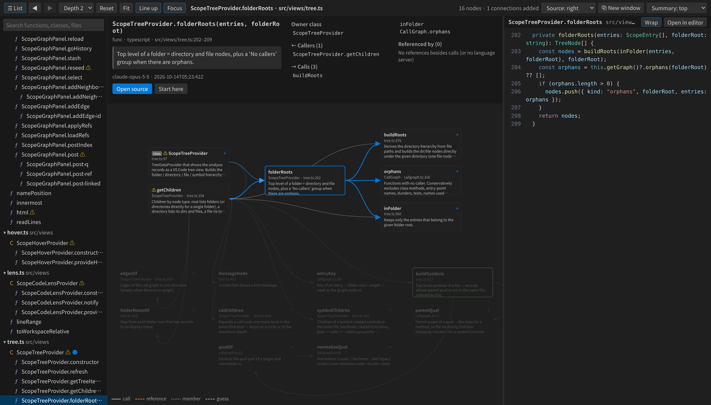
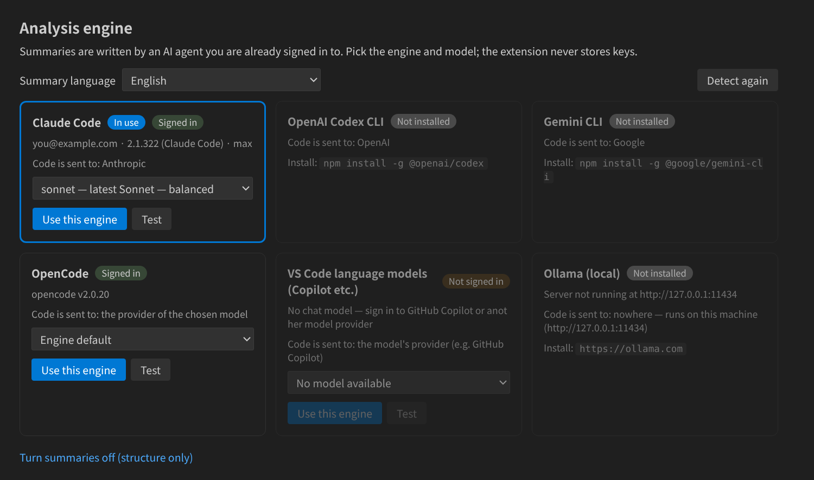

# Project Scope
[English](README.md) · [한국어](README.ko.md) · [日本語](README.ja.md) · **简体中文** · [繁體中文](README.zh-tw.md)

> 一眼看清项目中每个函数的用途——摘要、调用图与过期检查，就在 VS Code 里。



Project Scope 为你的代码库建立**逐函数地图**：每个函数和类都有一段摘要，谁能调用它、它调用了什么，以及代码在摘要生成之后是否改动过。
结构信息来自 VS Code 自带的语言服务器。摘要则由你**已经登录**的 AI 智能体生成，例如 Claude Code、Codex、Gemini、OpenCode、GitHub Copilot 或本地 Ollama 模型。Project Scope **从不索取也不保存 API 密钥**。

所有数据以纯 JSON Lines 形式保存在 `.scope/analysis.jsonl` 中。你可以把它提交到版本库、与团队共享，或让其他 AI 智能体写入。

---

## 它能做什么

### 快速读懂陌生的代码库
- 在 **Project Scope** 侧边栏中浏览:`文件夹 › 文件 › 类 › 函数`,每一项都附带摘要。
- 将鼠标悬停在编辑器中的任意函数上,即可查看其摘要、参数和调用。
- 在树中展开某个函数,即可递归查看 **→ 调用** 与 **← 调用方**。循环调用会标记为 ↻。

### 可视化探索调用链
- 打开 **Scope Explorer**:一个三栏窗口,包含**源码列表**、可交互的**调用图**和**摘要面板**。
- 点击节点即可把它的调用方、被调用方、**引用**(通过语言服务器的 *查找引用*)以及类成员加入画布。图会随着你的探索不断生长,还可以在各个起点之间前进和后退。
- **排布一线**会把所选函数的整条上游(调用方,在左侧)和下游(被调用方,在右侧)排进同一水平条带,并把其余内容移到下方变暗的区域。卡片会滑动到位,让你看清哪些元素移动了。关闭它即可回到普通分栏布局。**聚焦**则会单独把与所选内容无关的部分变暗。
- 摘要面板默认位于**调用图上方**,一侧显示摘要,另一侧显示调用方、调用和引用。你也可以把它移到右侧或隐藏。
- 代码显示在停靠于下方、右侧或左侧的**源码窗格**中,配色与你的 VS Code 主题一致。
- 可将任意调用链复制为 **Mermaid 流程图**,用于文档或拉取请求。

在顶部的截图中,选中的是 `folderRoots`:它的调用方排在左侧,它调用的函数排在右侧,画布其余部分变暗置于下方,⚠ 标记的是摘要生成之后代码又改动过的函数。

### 代码变动时保持摘要可信
- 每条摘要都会保存函数体的哈希值。函数体一旦变化,该函数就会显示 ⚠ **已过期**。
- **刷新 ↻** 通过语言服务器重新读取结构。它不使用 LLM,不产生任何开销。
  - 被移动的函数保留原有摘要。
  - 被删除的函数会标记为已删除。
  - 新函数显示为*尚未分析*。
- 刷新会在保存时、启动时以及切换分支、拉取或提交之后自动运行。
- **分析 ✦** 只把过期和新出现的函数发送给你的 AI 引擎。你可以分析所有需要处理的内容、当前文件、光标所在函数,也可以从树、调用图、悬停提示或 CodeLens 分析单个函数。
- 可选的**自动分析**会在你点击或保存文件时为改动的函数生成摘要,并设有每小时限额。

### 发现死代码候选
- **无调用方**分组列出在项目内未发现调用方的函数。检测策略是保守的:入口点、测试、类方法以及按名称引用的函数都会被排除。

### 选用你已在用的 AI 引擎
- **Scope: Choose Analysis Engine** 会检测已安装并登录的智能体,并逐一显示账号、代码会被发送到哪里、可用模型以及**测试**按钮。

| 引擎 | 调用方式 | 代码发送到 |
|---|---|---|
| Claude Code | `claude -p`(你已登录的 CLI)| Anthropic |
| OpenAI Codex CLI | `codex exec --sandbox read-only` | OpenAI |
| Gemini CLI | `gemini -p` | Google |
| OpenCode | `opencode run` | 你在 OpenCode 中配置的提供商 |
| VS Code 语言模型 | `vscode.lm`(GitHub Copilot 等)| 该模型所属的提供商 |
| Ollama | 本地 HTTP API | **始终留在你的机器上** |



### 用你的语言工作
- 界面支持 English、한국어、日本語、简体中文和繁體中文,跟随 VS Code 的显示语言。
- 摘要也可以用上述任意语言书写。首次分析时,Project Scope 会询问使用哪种语言,并根据你现有摘要中最常用的语言给出建议,然后把你的选择保存到工作区。

### 让其他 AI 智能体参与贡献
- **Scope: Install Contract (AGENTS.md)** 会在项目根目录写入一页式 schema。把它交给任意编码智能体(Claude Code、Cursor、Codex……),该智能体就能把自己的分析追加到 `.scope/analysis.jsonl`。该文件只追加不修改,同一函数以最后一行为准,因此扩展和各智能体可以安全地共用它。

---

## 快速上手

1. 安装扩展并打开一个项目。
2. 在命令面板中运行 **Scope: Choose Analysis Engine**,选择一个你已登录的引擎,按**测试**验证可用。
3. 打开一个源码文件,运行 **Scope: Analyze → Current file**,在提示时选择摘要语言。
4. 在活动栏中打开 **Project Scope** 视图,或点击状态栏中的 `Scope …` 打开资源管理器。

要想一次性分析整个文件夹,请设置 `projectScope.scanInclude`(例如 `src/**`),然后运行 **Scope: Analyze → Everything that needs analysis**。
一旦部分文件完成分析,同一批顶层文件夹中的新文件会被自动纳入。

**支持的语言:** TypeScript/JavaScript、Python、C#、C/C++、Rust、Go、Java、Kotlin、Swift、Ruby、PHP、Scala 和 Dart。
每种语言都需要一个提供文档符号的语言服务器,通常随该语言的 VS Code 扩展一起安装。用于区分同名函数的 import 追踪支持 Python、TS/JS、C#、C/C++、Rust、Go 和 Java/Kotlin。

---

## 命令

| 命令 | 作用 |
|---|---|
| `Scope: Refresh` | 重新加载记录并重读结构(移动、新增和删除的函数)。不使用 LLM。 |
| `Scope: Analyze` | 为所有需要处理的内容、当前文件或光标所在函数生成摘要。可取消。 |
| `Scope: Choose Analysis Engine` | 检测已登录的智能体,选择引擎、模型和摘要语言,并运行测试。 |
| `Scope: Open Explorer` | 打开 列表 · 调用图 · 摘要 窗口。 |
| `Scope: Open Explorer at This Function` | 从光标所在函数打开资源管理器(编辑器标题栏按钮)。 |
| `Scope: Open Call Graph` | 同上,针对光标处或在树中选中的函数或类。 |
| `Scope: Show Summary` | 显示当前符号的摘要。 |
| `Scope: Show Flow` | 列出它调用的函数并跳转过去。 |
| `Scope: Show Callers` | 列出调用它的函数并跳转过去。 |
| `Scope: Copy Mermaid Flowchart` | 将调用链复制为 Mermaid 格式。 |
| `Scope: Install Contract (AGENTS.md)` | 为外部智能体写入分析 schema 并创建 `.scope/`。 |

同样的操作也可以通过树的右键菜单、内联按钮、CodeLens 和悬停链接使用。
状态栏(`Scope 210 · ⚠3 · new 2`)点击可打开资源管理器,其悬停提示中带有刷新、分析和引擎选择入口。

---

## 设置

### 分析引擎

| 设置 | 默认值 | 说明 |
|---|---|---|
| `projectScope.analyzer` | `claude-cli` | 生成摘要的引擎:`claude-cli`、`codex-cli`、`gemini-cli`、`opencode`、`vscode-lm`、`ollama` 或 `off`。设为 `off` 时只刷新结构,不向任何地方发送代码。 |
| `projectScope.analyzeModel` | `sonnet` | 以引擎自身格式表示的模型名,例如 Claude Code 的 `sonnet` / `haiku` / `opus`,或 OpenCode 的 `provider/model`。留空则使用引擎默认值。 |
| `projectScope.summaryLanguage` | `ask` | 摘要语言。`ask` 会在首次分析前询问并把答案保存到工作区。其他取值:`ui`(VS Code 显示语言)、`auto`(与代码注释一致)、`en`、`ko`、`ja`、`zh-cn`、`zh-tw`。 |
| `projectScope.claudePath` | `claude` | Claude Code CLI 的路径,当它不在 `PATH` 中时使用。 |
| `projectScope.codexPath` | `codex` | Codex CLI 的路径。 |
| `projectScope.geminiPath` | `gemini` | Gemini CLI 的路径。 |
| `projectScope.opencodePath` | `opencode` | OpenCode CLI 的路径。 |
| `projectScope.ollamaUrl` | `http://127.0.0.1:11434` | Ollama 服务器地址。 |

### 自动任务

| 设置 | 默认值 | 说明 |
|---|---|---|
| `projectScope.autoAnalyze` | `off` | `off`:仅在你按下分析时。`onClick`:在树或调用图中点击有改动或新增的函数时。`onSave`:点击时,以及保存文件时对该文件中改动或新增的函数。会消耗你的 AI 引擎。 |
| `projectScope.autoAnalyzeMaxPerHour` | `60` | 自动分析每小时可生成摘要的函数数量上限。手动分析不受限制。 |
| `projectScope.scanOnSave` | `true` | 保存时重读该文件的结构。不使用 LLM。 |
| `projectScope.scanOnStartup` | `true` | 启动数秒后刷新结构。不使用 LLM。 |
| `projectScope.gitIntegration` | `true` | 将 git 改动和未跟踪的文件纳入刷新,并在切换分支、拉取或提交后再次刷新。没有 git 时也能通过哈希值工作。 |
| `projectScope.scanInclude` | *(空)* | 用于发现新源码文件的 glob,相对于工作区文件夹。留空表示沿用已分析文件所在的顶层文件夹(如 `src/**`)。 |
| `projectScope.scanExclude` | `**/{node_modules,out,dist,build,target,bin,obj,.git,.scope,test,tests,__tests__,spec,fixtures,vendor,third_party}/**` | 查找新文件时跳过的路径 glob。 |

### 视图

| 设置 | 默认值 | 说明 |
|---|---|---|
| `projectScope.graphOpenIn` | `window` | 资源管理器首次打开的位置:`window`(独立的 VS Code 窗口)、`beside`(旁边编辑器组中的标签页)或 `active`(当前组中的标签页)。 |
| `projectScope.openExplorerOnStartup` | `false` | 打开工作区时自动打开资源管理器。 |
| `projectScope.graphDepth` | `3` | 调用图和 Mermaid 导出的默认被调用层级(1–4,可在资源管理器中调整)。 |
| `projectScope.callTreeMaxDepth` | `6` | 在树中展开调用链和调用方链的最大深度。 |
| `projectScope.jsonlPath` | `.scope/analysis.jsonl` | 分析记录的位置,相对于工作区。 |

---

## 隐私与成本

- **无需 API 密钥。** Project Scope 调用的是你已经登录的 CLI 或 VS Code 模型,直接复用该工具自身的身份验证。CLI 在临时目录中运行,因此不会读取你的项目文件或智能体指令。
- **发送的内容:** 只有被分析函数的函数体,加上函数名和文件路径,会发送到你选择的引擎。引擎选择器会显示每个引擎把代码发送到哪里。使用 **Ollama** 可让代码留在本机,或将 `projectScope.analyzer` 设为 `off` 则不发送任何内容。
- **花钱的部分:** 只有分析会消耗引擎的配额或计费。刷新、树、调用图、悬停提示和过期检测均免费,且可离线工作。
- **存储的内容:** 工作区中的 `.scope/analysis.jsonl`。它只保存摘要和元数据,不是代码副本。

---

## 记录格式

`.scope/analysis.jsonl` 的每一行对应一个函数或类:

```json
{"v":1,"target":"func:src/core.py:build_slice","kind":"func","name":"build_slice",
 "file":"src/core.py","line":186,"endLine":214,"lang":"python","srcHash":"a3f9c1d2e4b5a6c7",
 "summary":"Builds the call slice around a seed function…","calls":["_resolve"],
 "model":"claude-sonnet-4-5","generatedAt":"2026-10-12T09:30:00Z"}
```

完整 schema 见 [AGENTS.md](AGENTS.md)。

---

## 环境要求

- VS Code 1.90 或更高版本。支持 Remote SSH 远程开发,并内置远程主机的语法高亮配色。
- 要生成摘要,需满足以下之一:安装并登录 Claude Code、Codex CLI、Gemini CLI 或 OpenCode;使用 GitHub Copilot 等 VS Code 聊天模型;或运行一台 Ollama 服务器。

## 第三方组件

- `vscode-textmate`、`vscode-oniguruma`(MIT,Microsoft),用于语法分词。
- `resources/syntax`:来自 [tm-grammars / tm-themes](https://github.com/shikijs/textmate-grammars-themes) 的 TextMate 语法和主题。原始许可见 `resources/syntax/NOTICE-grammars` 和 `LICENSE-*`。

## 许可证

MIT
