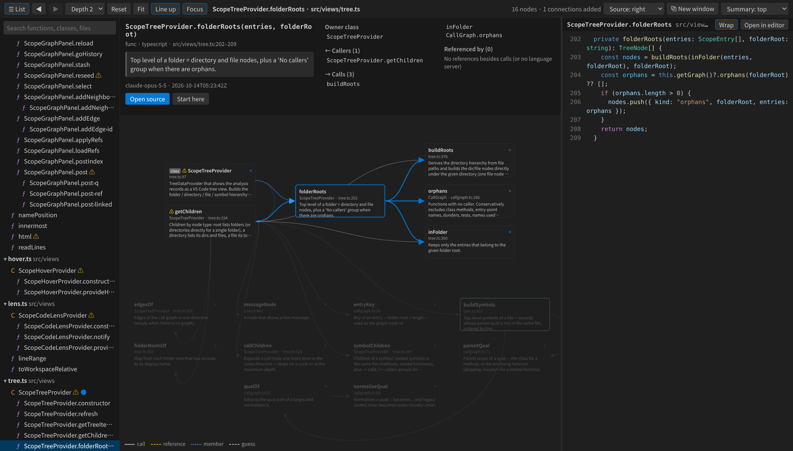
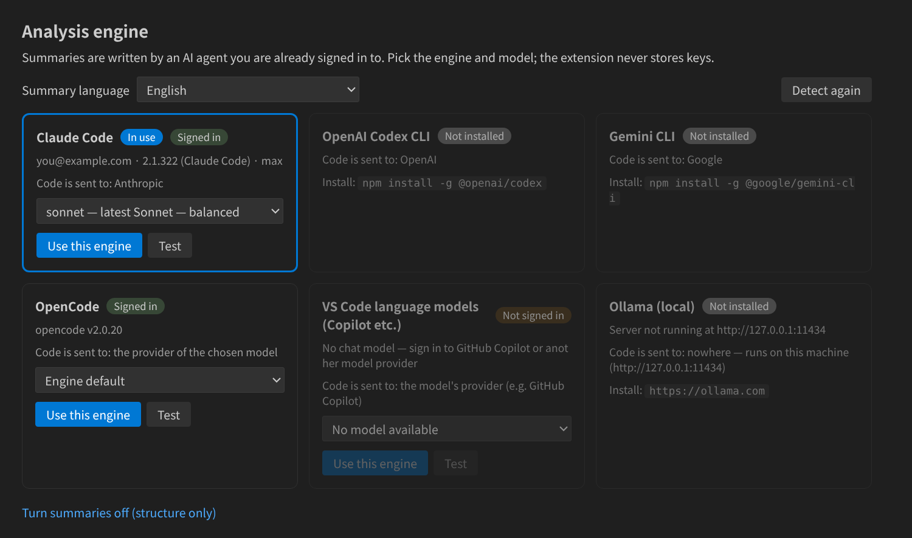

# Project Scope
[English](README.md) · [한국어](README.ko.md) · [日本語](README.ja.md) · [简体中文](README.zh-CN.md) · **繁體中文**

> 看看專案裡每個函式在做什麼——摘要、呼叫圖與過期檢查，就在 VS Code 裡。



Project Scope 為你的程式碼庫建立**逐一函式的地圖**：每個函式與類別的一段式摘要、誰呼叫它、它呼叫了什麼，以及程式碼在上次摘要後是否變動過。
程式結構來自 VS Code 內建的語言伺服器。摘要則來自你**已經登入的** AI 代理，例如 Claude Code、Codex、Gemini、OpenCode、GitHub Copilot 或本機的 Ollama 模型。Project Scope **絕不要求或儲存 API 金鑰**。

所有資料都以純 JSON Lines 儲存在 `.scope/analysis.jsonl`。你可以將它納入版本控、與團隊共享，或讓其他 AI 代理寫入。

---

## 你能用它做什麼

### 快速看懂陌生的程式碼庫
- 瀏覽 **Project Scope** 側邊欄：`資料夾 › 檔案 › 類別 › 函式`，每個項目都附帶摘要。
- 在編輯器中將滑鼠懸停在任何函式上，即可閱讀其摘要、參數與呼叫。
- 在樹狀圖中展開函式，即可遞迴檢視**→ 呼叫**與**← 呼叫者**。循環會標記為 ↻。

### 視覺化探索呼叫流程
- 開啟 **Scope Explorer**：一個三窗格視窗，包含**來源清單**、可互動的**呼叫圖**與**摘要面板**。
- 點擊節點即可將其呼叫者、被呼叫者、**參考**（透過語言伺服器的 *Find References*）與類別成員加入畫布。圖形會隨著你的探索而成長，並可在各起點之間前進與後退。
- **Line up** 會將所選函式的整個上游（呼叫者，在左）與下游（被呼叫者，在右）排成同一水平帶，其餘全部移到下方變暗的區域。卡片會滑入定位，讓你看清楚什麼被移動了。關閉它即可回到單純的欄狀版面。**Focus** 則另行將與選取項目無關的所有內容變暗。
- 摘要面板預設位於**圖形上方**，一側是摘要，另一側是呼叫者、呼叫與參考。你也可以把它移到右側或隱藏。
- 在下方、右側或左側停靠的**原始碼窗格**中閱讀程式碼。配色與你的 VS Code 佈景主題一致。
- 將任何呼叫流程複製為 **Mermaid 流程圖**，用於文件或Pull Request。

在最上方的螢幕截圖中，選取的是 `folderRoots`。它的呼叫者排列在左側，它呼叫的函式在右側。畫布其餘部分在下方變暗，⚠ 標記摘要之後程式碼有變動的函式。

### 程式碼變動時保持摘要可信
- 每筆摘要都記錄函式主體的雜湊值。主體變動時，該函式會顯示 ⚠ **過期**。
- **重新整理 ↻** 透過語言伺服器重新讀取結構。不使用 LLM，完全免費。
  - 被搬移的函式保留其摘要。
  - 被刪除的函式會標記為已刪除。
  - 新函式顯示為*尚未分析*。
- 重新整理會在儲存檔案、啟動時，以及 git 切換分支、拉取或提交之後自動執行。
- **分析 ✦** 只將過期與新增的函式送到你的 AI 引擎。你可以分析所有需要分析的項目、目前的檔案、游標所在函式，或從樹狀圖、呼叫圖、懸停提示或 CodeLens 分析單一函式。
- 選用的**自動分析**會在你點擊或儲存檔案時摘要變動的函式，每小時有次數上限。

### 找出死碼候選
- **無呼叫者**群組列出專案內找不到呼叫者的函式。偵測方式相當保守：進入點、測試、類別方法與以名稱參考的函式都會排除。

### 選用你已經在用的 AI 引擎
- **Scope: Choose Analysis Engine** 會偵測哪些代理已安裝並登入。針對每個代理，它會顯示帳號、你的程式碼會被送到哪裡、可用的模型，以及**測試**按鈕。

|| 引擎 | 呼叫方式 | 程式碼送到 |
||---|---|---|
|| Claude Code | `claude -p`（你已登入的 CLI） | Anthropic |
|| OpenAI Codex CLI | `codex exec --sandbox read-only` | OpenAI |
|| Gemini CLI | `gemini -p` | Google |
|| OpenCode | `opencode run` | 你在 OpenCode 設定的供應商 |
|| VS Code 語言模型 | `vscode.lm`（GitHub Copilot 等） | 該模型的供應商 |
|| Ollama | 本機 HTTP API | **留在你的機器上** |



### 以你的語言使用
- 介面提供 English、한국어、日本語、简体中文與繁體中文，跟隨 VS Code 的顯示語言。
- 摘要可用上述任何語言撰寫。首次分析時，Project Scope 會詢問要使用哪一種。它會建議你現有摘要最常用的語言，並將選擇儲存到工作區。

### 讓其他 AI 代理共同參與
- **Scope: Install Contract (AGENTS.md)** 會在專案根目錄寫入一頁式的結構描述（schema）。把它交給任何程式開發代理（Claude Code、Cursor、Codex……），該代理就能將自己的分析附加到 `.scope/analysis.jsonl`。此檔案為僅限附加，每個函式以最後一行為準，因此擴充功能與各代理可以安全地共用。

---

## 開始使用

1. 安裝擴充功能並開啟一個專案。
2. 從命令面板執行 **Scope: Choose Analysis Engine**，選擇一個你已登入的引擎。按**測試**檢查是否可用。
3. 開啟一個原始碼檔案，執行 **Scope: Analyze → Current file**。出現提示時選擇摘要語言。
4. 在活動列開啟 **Project Scope** 視圖，或點擊狀態列的 `Scope …` 開啟 Explorer。

若要一次分析整個資料夾，請設定 `projectScope.scanInclude`（例如 `src/**`），然後執行 **Scope: Analyze → Everything that needs analysis**。
一旦部分檔案完成分析，相同頂層資料夾中的新檔案會被自動納入。

**支援的語言：** TypeScript/JavaScript、Python、C#、C/C++、Rust、Go、Java、Kotlin、Swift、Ruby、PHP、Scala 與 Dart。
每種語言都需要一個提供文件符號的語言伺服器，通常透過該語言的 VS Code 擴充功能安裝。用於區分同名函式的 import 追蹤支援 Python、TS/JS、C#、C/C++、Rust、Go 與 Java/Kotlin。

---

## 命令

|| 命令 | 作用 |
||---|---|
|| `Scope: Refresh` | 重新載入紀錄並重讀結構（搬移、新增與刪除的函式）。不使用 LLM。 |
|| `Scope: Analyze` | 為所有需要分析的項目、目前檔案或游標所在函式撰寫摘要。可取消。 |
|| `Scope: Choose Analysis Engine` | 偵測已登入的代理，選擇引擎、模型與摘要語言，並執行測試。 |
|| `Scope: Open Explorer` | 開啟清單 · 圖形 · 摘要視窗。 |
|| `Scope: Open Explorer at This Function` | 從游標所在函式開啟 Explorer（編輯器標題按鈕）。 |
|| `Scope: Open Call Graph` | 同上，對象為游標所在或樹狀圖中選取的函式或類別。 |
|| `Scope: Show Summary` | 顯示目前符號的摘要。 |
|| `Scope: Show Flow` | 列出它呼叫的函式並可跳轉。 |
|| `Scope: Show Callers` | 列出呼叫它的函式並可跳轉。 |
|| `Scope: Copy Mermaid Flowchart` | 將呼叫流程複製為 Mermaid 圖。 |
|| `Scope: Install Contract (AGENTS.md)` | 為外部代理寫入分析結構描述，並建立 `.scope/`。 |

同樣的動作也可以從樹狀圖的右鍵選單、內嵌按鈕、CodeLens 與懸停連結使用。
狀態列（`Scope 210 · ⚠3 · new 2`）可開啟 Explorer，其工具提示則有重新整理、分析與引擎選擇的連結。

---

## 設定

### 分析引擎

|| 設定 | 預設值 | 說明 |
||---|---|---|
|| `projectScope.analyzer` | `claude-cli` | 撰寫摘要的引擎：`claude-cli`、`codex-cli`、`gemini-cli`、`opencode`、`vscode-lm`、`ollama` 或 `off`。設為 `off` 時只會重新整理結構，不會送出任何程式碼。 |
|| `projectScope.analyzeModel` | `sonnet` | 以引擎本身格式表示的模型名稱，例如 Claude Code 的 `sonnet` / `haiku` / `opus`，或 OpenCode 的 `provider/model`。留空則使用引擎預設值。 |
|| `projectScope.summaryLanguage` | `ask` | 摘要的語言。`ask` 會在首次分析前詢問，並將答案儲存到工作區。其他值：`ui`（VS Code 顯示語言）、`auto`（跟隨程式碼註解）、`en`、`ko`、`ja`、`zh-cn`、`zh-tw`。 |
|| `projectScope.claudePath` | `claude` | Claude Code CLI 的路徑，若它不在 `PATH` 上。 |
|| `projectScope.codexPath` | `codex` | Codex CLI 的路徑。 |
|| `projectScope.geminiPath` | `gemini` | Gemini CLI 的路徑。 |
|| `projectScope.opencodePath` | `opencode` | OpenCode CLI 的路徑。 |
|| `projectScope.ollamaUrl` | `http://127.0.0.1:11434` | Ollama 伺服器 URL。 |

### 自動化作業

|| 設定 | 預設值 | 說明 |
||---|---|---|
|| `projectScope.autoAnalyze` | `off` | `off`：僅在你按下分析時。`onClick`：在樹狀圖或呼叫圖中點擊已變更或新增的函式時。`onSave`：點擊時，以及儲存檔案時對檔案中已變更或新增的函式。使用你的 AI 引擎。 |
|| `projectScope.autoAnalyzeMaxPerHour` | `60` | 自動分析每小時摘要的函式數上限。手動分析則無限制。 |
|| `projectScope.scanOnSave` | `true` | 儲存時重新讀取該檔案的結構。不使用 LLM。 |
|| `projectScope.scanOnStartup` | `true` | 啟動後數秒重新整理結構。不使用 LLM。 |
|| `projectScope.gitIntegration` | `true` | 在重新整理時納入 git 變更與未追蹤的檔案，並於切換分支、拉取或提交後重新整理。沒有 git 也能運作，靠的是雜湊值。 |
|| `projectScope.scanInclude` | *（空）* | 用於尋找新原始碼檔案的 glob，相對於工作區資料夾。留空表示已分析檔案所在的頂層資料夾（例如 `src/**`）。 |
|| `projectScope.scanExclude` | `**/{node_modules,out,dist,build,target,bin,obj,.git,.scope,test,tests,__tests__,spec,fixtures,vendor,third_party}/**` | 尋找新檔案時要略過的路徑 glob。 |

### 視圖

|| 設定 | 預設值 | 說明 |
||---|---|---|
|| `projectScope.graphOpenIn` | `window` | Explorer 第一次開啟的位置：`window`（獨立的 VS Code 視窗）、`beside`（相鄰編輯器群組的分頁）或 `active`（目前群組的分頁）。 |
|| `projectScope.openExplorerOnStartup` | `false` | 開啟工作區時一併開啟 Explorer。 |
|| `projectScope.graphDepth` | `3` | 呼叫圖與 Mermaid 匯出的預設被呼叫深度（1–4，可在 Explorer 中調整）。 |
|| `projectScope.callTreeMaxDepth` | `6` | 在樹狀圖中展開呼叫與呼叫者鏈的最大深度。 |
|| `projectScope.jsonlPath` | `.scope/analysis.jsonl` | 分析紀錄的位置，相對於工作區。 |

---

## 隱私與成本

- **不需要 API 金鑰。** Project Scope 呼叫你已登入的 CLI 或 VS Code 模型，使用該工具自身的驗證。CLI 在暫存目錄中執行，因此不會讀取你的專案檔案或代理指示。
- **送出的內容：** 只有被分析函式的主體，加上其名稱與檔案路徑，會送到你選擇的引擎。引擎選擇器會顯示每個引擎將程式碼送到何處。想讓程式碼留在本機就使用 **Ollama**，或將 `projectScope.analyzer` 設為 `off` 完全不送出。
- **花錢的部分：** 只有「分析」會消耗你引擎的額度或計費。重新整理、樹狀圖、呼叫圖、懸停提示與過期偵測都免費且可離線運作。
- **儲存的內容：** 工作區中的 `.scope/analysis.jsonl`。它只保存摘要與中繼資料，不是你程式碼的副本。

---

## 紀錄格式

`.scope/analysis.jsonl` 的每一列是一個函式或類別：

```json
{"v":1,"target":"func:src/core.py:build_slice","kind":"func","name":"build_slice",
 "file":"src/core.py","line":186,"endLine":214,"lang":"python","srcHash":"a3f9c1d2e4b5a6c7",
 "summary":"Builds the call slice around a seed function…","calls":["_resolve"],
 "model":"claude-sonnet-4-5","generatedAt":"2026-10-12T09:30:00Z"}
```

完整結構描述見 [AGENTS.md](AGENTS.md)。

---

## 需求

- VS Code 1.90 以上版本。支援 Remote SSH，並為遠端主機內建語法配色。
- 若要產生摘要，需具備其一：已安裝並登入 Claude Code、Codex CLI、Gemini CLI 或 OpenCode；GitHub Copilot 等 VS Code 聊天模型；或一部 Ollama 伺服器。

## 第三方元件

- `vscode-textmate`、`vscode-oniguruma`（MIT，Microsoft），用於語法斷詞。
- `resources/syntax`：來自 [tm-grammars / tm-themes](https://github.com/shikijs/textmate-grammars-themes) 的 TextMate 文法與佈景主題。原始授權見 `resources/syntax/NOTICE-grammars` 與 `LICENSE-*`。

## 授權

MIT
